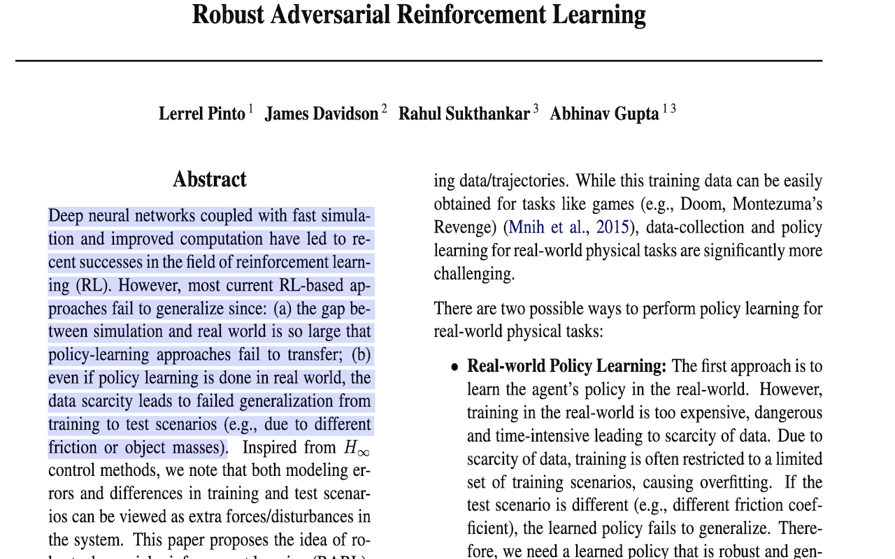
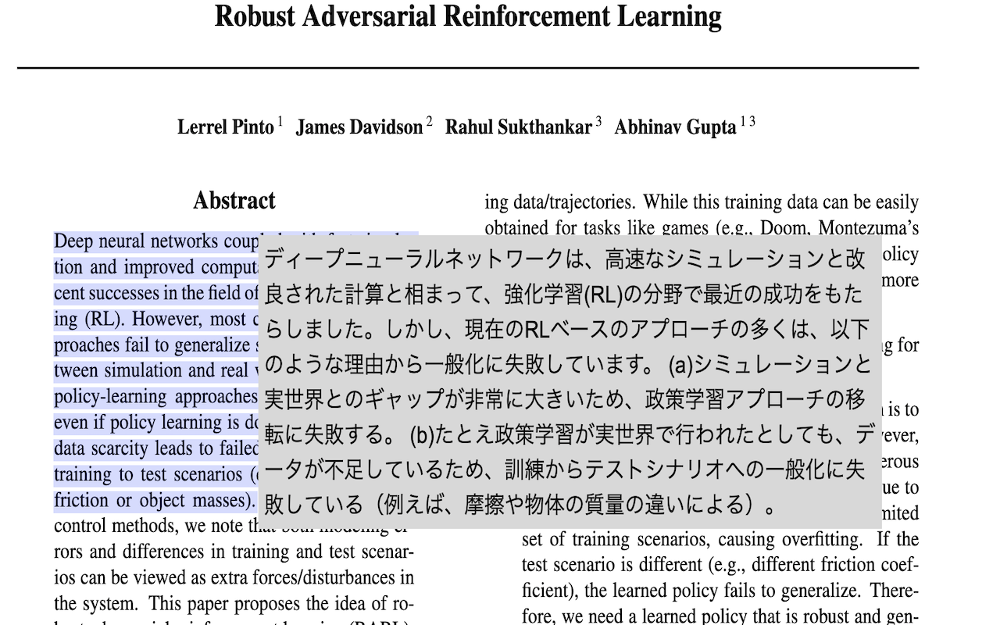

# PDF Translator

## Overview
This is a Manifest V3 Chrome extension that automatically corrects selected text directly from a PDF file and displays the translation results with DeepL.

This is an "unofficial" chrome extension and we are not responsible for any disadvantages caused by this extension.
This Chrome extension is """not affiliated with DeepL""".

The following languages are supported.
- English
- 日本語
- Deutsche
- Français
- Español
- Português
- Italiano
- Nederlands
- Polski
- русский
- 汉语

This Chrome extension includes 4 corrections to produce a clean translation for DeepL.
- Remove line breaks in the middle of a sentence.
- Remove "-" from a word.
- "A space is inserted immediately after ". Insert a space if there is a capital letter immediately after the ".
- A new line is inserted immediately after ";" and ":".

## How to use
1. Select the text you want to translate.

2. It will be translated.

## Install from source

1. Open `chrome://extensions` in Chrome.
2. Enable **Developer mode**.
3. Click **Load unpacked** and select this repository.

The toolbar icon toggles automatic PDF handling on and off.

## Local PDF files

Chrome requires explicit permission before an extension can access `file://` URLs:

1. Open `chrome://extensions`.
2. Open the details page for **PDF Translator**.
3. Enable **Allow access to file URLs**.

After permission is enabled, opening a local `.pdf` file uses the bundled PDF.js viewer in the same way as an HTTP or HTTPS PDF.

## Manifest version

Version 4.0.0 uses Chrome Extension Manifest V3. The bundled PDF.js version remains unchanged for this migration.

This implementation includes [pdf.js](https://github.com/mozilla/pdf.js).

Icon made by Pixel perfect from www.flaticon.com
